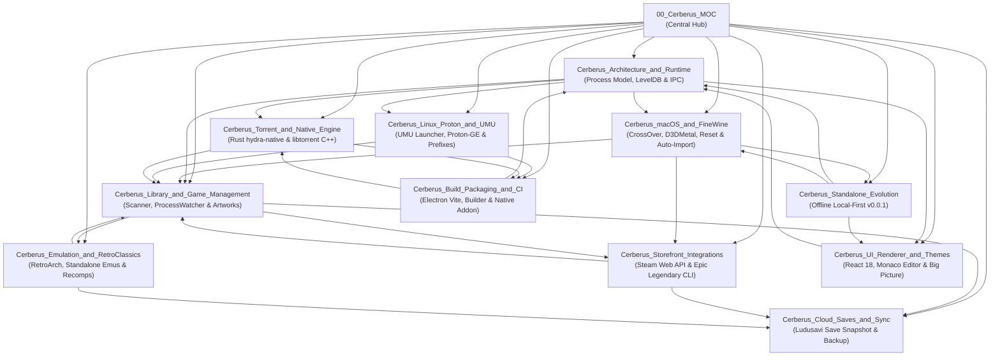

# Map of Content: Cerberus Gaming Platform

O **Cerberus** (evoluído a partir do Hydra Launcher) é uma plataforma e gerenciador de biblioteca de jogos aberta, de alto desempenho e standalone, construída com Node.js (Electron, React, TypeScript), Rust (`hydra-native`) e C++ (`libtorrent`).

Projetado originalmente para Windows e Linux, o Cerberus foi reimaginado com uma arquitetura **local-first** e otimizações de ponta para **macOS Apple Silicon**, integrando backends de execução Windows via Wine/CrossOver/D3DMetal, descoberta automática de jogos em garrafas, enriquecimento de capas e operação completamente autônoma e offline.

---

## 🗺️ Grafo de Conhecimento (Cerberus MOC Architecture Graph)

---

## 📚 Categorias do Segundo Cérebro

### 1. ⚙️ Núcleo de Sistema & Arquitetura

- [[Cerberus_Architecture_and_Runtime]]: O modelo de três processos do Electron (Main, Preload e Renderer), barramento IPC seguro com canais bidirecionais, protocolos customizados (`local://`, `gradient://`) e persistência no banco embutido LevelDB (`classic-level`).
- [[Cerberus_Torrent_and_Native_Engine]]: Camada de baixo nível de download e torrents. O addon Rust `hydra-native` empacotado via neon/napi, a bridge C++ para `libtorrent`, orquestração assíncrona com `DownloadOrchestrator` e integração com descompressão via 7-Zip.
- [[Cerberus_Standalone_Evolution]]: O manifesto e registro técnico da evolução do Cerberus para um launcher standalone, removendo o acoplamento obrigatório de autenticação na nuvem, rankings globais e telemetria, priorizando autonomia local e portabilidade no macOS.

### 2. 🎮 Ambientes de Execução de Jogos (Compatibility Layers)

- [[Cerberus_macOS_and_FineWine]]: A espinha dorsal no macOS: subsistema `src/main/services/crossover`, detecção e varredura de garrafas de jogos (`CrossOverDiscovery`), roteamento universal com backends `D3DMetal` (Game Porting Toolkit), `DXMT` e `DXVK`, provisionamento de trial (`CrossOverProvisioner`), enriquecimento automático de metadados Steam, modo seguro para instaladores FitGirl/Repacks, centralização de armazenamento em `Cerberus_Cache` e pipeline de porting Switch (macOS, iOS e Android).
- [[Cerberus_Linux_Proton_and_UMU]]: Pipeline de compatibilidade no Linux através do UMU (Unified Linux Launcher) e Proton GE. Gerenciamento de Wine prefixes, Winetricks, GameMode, MangoHud e sessões Wayland.

### 3. 📦 Gestão de Biblioteca, Lojas & Emulação

- [[Cerberus_Library_and_Game_Management]]: Indexação de títulos, detecção de executáveis (`scan-installed-games.ts`), rastreamento em tempo real de execução e tempo de jogo via `ProcessWatcher` (monitoramento de árvore de PIDs) e cache de capas SteamGridDB.
- [[Cerberus_Storefront_Integrations]]: Pontes com lojas oficiais: autenticação e sincronização com Steam (OpenID e APIs de detalhes de pacotes) e orquestração do cliente Epic Games via o utilitário CLI Legendary.
- [[Cerberus_Emulation_and_RetroClassics]]: Ecossistema Cerberus Classics para consoles retro: detecção e lançamento de ROMs no DuckStation, PCSX2, RPCS3, shadPS4, PPSSPP, Dolphin e RetroArch, além de suporte a recompilações estáticas nativas de PC.
- [[Cerberus_Cloud_Saves_and_Sync]]: Mecanismo de persistência e salvamento local/nuvem baseado no integrador Ludusavi, mapeamento automatizado de pastas de savegame e resolução de conflitos.

### 4. 🎨 Interface, Experiência & Empacotamento

- [[Cerberus_UI_Renderer_and_Themes]]: Frontend moderno construído com React 18, Redux Toolkit, virtualização com `@tanstack/react-virtual`, sistema de temas customizáveis com editor Monaco em tempo real e modo Big Picture voltado para controles/TV.
- [[Cerberus_Build_Packaging_and_CI]]: Configuração de compilação com `electron-vite`, scripts de empacotamento multi-plataforma (`electron-builder.yml`), compilação nativa de addons (`build-native-addon.cjs`) e geração de bundles `.app` (macOS), AppImage/deb (Linux) e instaladores Windows.

---

## 🧭 Guias Rápidos de Navegação

- Para entender o funcionamento do motor de compatibilidade no Mac, veja [[Cerberus_macOS_and_FineWine]].
- Para entender o ciclo de vida e a base de dados local, leia [[Cerberus_Architecture_and_Runtime]].
- Para analisar a transformação de dependência web para standalone, consulte [[Cerberus_Standalone_Evolution]].
- Para consultar o pipeline de compilação dos módulos Rust e C++, veja [[Cerberus_Torrent_and_Native_Engine]].
